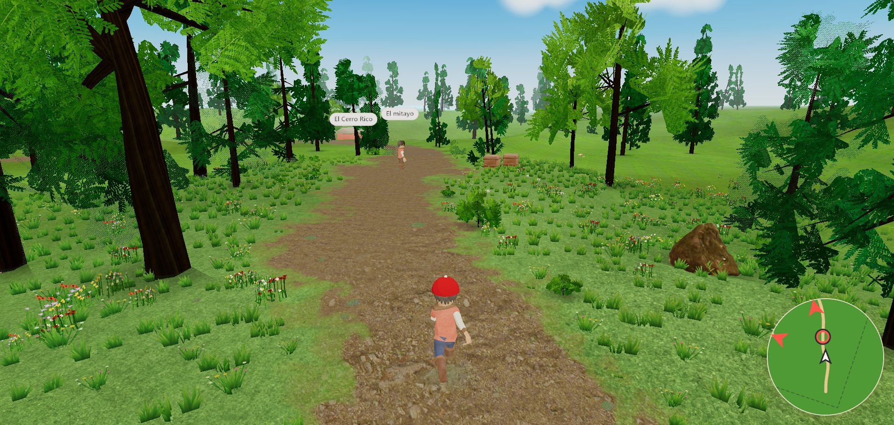
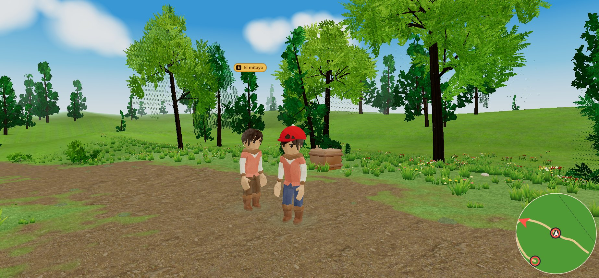
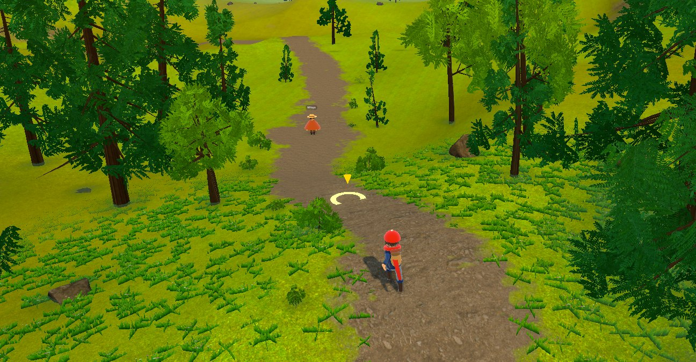

# Mundo Rush

**A browser game where you learn a second language by living in a world and talking to its people. You choose the
world: the book or film you love becomes the game.**

One engine, any universe. The player picks a book or a film. Mundo Rush researches that universe in the background,
asks the player a few questions to finish defining it, and builds a playable world from it: its places, its
characters, its missions and what there is to discover. The engine and the learning method are always the same;
only the world changes.

Inside that world, you walk a 3D open world in third person, meet characters, and talk to them out loud, in the language you are
learning. The characters answer by voice, in character, and an AI evaluates what you said against the goals of the
scene: did you ask the right question, did you understand, did you get your point across. A scene ends when you
actually achieve something in the conversation, not when you pick the right option.

For teenagers and adults. The first fully supported languages will be **Spanish, English and Portuguese** (a native
speaker of any of them learns either of the others); the pair playable today is Spanish → English.

> Status: working prototype, in active development. Built and played on PC in the browser. Development started in
> June 2026 with an earlier voice-tutor prototype (real-time voice conversation and correction); this repository
> starts in October 2026, when that work became the game.

> **About this repository.** This is the public version of the project's private development repository. The
> commit history is the real one, with its original dates, authorship and order. Internal planning documents
> (decision log, roadmap, task plans, reports and research notes) were removed from it, and internal tool and
> reviewer names in comments were replaced by their role, so commit hashes differ from the private repository.
> For this public version, the documentation and the commit messages were translated from Spanish to English. Code
> comments are in English in both repositories (translated on 2026-10-31; older commits keep the Spanish ones). The
> game's Spanish texts are part of the product (the interface for Spanish speakers). Nothing else was changed.
> Access to the private repository can be given on request.

## What makes it different

- **Conversation is the game mechanic.** Most language apps teach recognition and isolated phrases with habit
  mechanics (streaks, leagues). Here the core loop is a real spoken conversation with a goal, inside a world with
  consequences.
- **Evaluation by meters, not by right answers.** A separate model labels each exchange (understanding, asking,
  following up, using what you learned) and the game adds it up. The character never breaks the scene to correct
  you.
- **Short scenes by design.** Real-time voice gets more expensive the longer a conversation runs, so scenes are
  short and repeatable. That also matches what the learning research recommends.
- **Your universe, the same engine.** The player chooses the book or film. A pipeline researches it, defines the
  world (with a short questionnaire to the player when choices are open) and emits a universe: places, characters,
  missions and the knowledge to discover, all checked against a schema. The engine and the learning method never
  change, so motivation comes from a story the player already cares about.
- **Content as data.** Worlds, characters, missions, conversations and safety rules are YAML files compiled and
  validated at build time. A new universe is new content, not new code.
- **Safety built in.** Model output goes through moderation (in text mode, before it is shown), with containment
  rules for sensitive topics, because the audience includes teenagers.

## What is built today

| Area | State |
|---|---|
| 3D open world | Third-person camera, continuous zoom to a full-map view, relief terrain, trees, grass, minimap with the characters still to visit, quality tiers for integrated GPUs |
| Characters | Animated rigs (CC0 assets), name labels, two-shot camera during conversations |
| Voice conversations | Real-time voice with Gemini Live; falls back to text if voice is unavailable |
| Evaluation | Observer and judge models score each turn; progress is saved when a scene succeeds |
| Universes | Two playable universes on the same engine: an original village story, and a test universe built from a book (the Potosí chapter of Eduardo Galeano's *Las venas abiertas de América Latina*), used to prove that a book can become a world |
| Universe pipeline | The universe contract and its final stage are real: the emit stage writes a complete, validated universe that the engine plays unchanged. The earlier stages (ingest, research, world definition, player questionnaire) are designed and stubbed; for the test universe their output was written by hand |
| Quality gates | Type checks, lint with module boundaries, about 2,000 unit tests, content validation, accessibility contrast check, bundle and asset budgets |

## What's next

1. **Playable MVP.** One player, one chosen universe, from the first minute to the end of its story.
   - **Universe pipeline, automatic.** Pick a book or film; background research of its places, characters,
     conflicts and facts; a world definition with checks that keep facts grounded in the source; a short
     questionnaire to the player for the open choices; then the universe is emitted and validated.
   - **World built from the universe.** Map layout, landmarks and the world's look generated from the universe
     definition, with characters and missions placed in it.
   - **Complete game loop.** Onboarding, a chain of missions with real progression, the companion that helps when
     the player gets stuck, rewards, and progress saved across sessions.
   - **Learning layer.** Level placement, spaced review of what the player has learned, pronunciation feedback, and
     a short debrief after each scene with what went well and what to practice.
   - **Voice and AI.** Lower latency, cost control per player, clear recovery when a model or the voice fails.
   - **Online and accounts.** Player accounts and a hosted version, so it runs from a link instead of a local setup.
   - **Performance.** 60 fps on integrated graphics and fast loading on a regular PC.
   - **Playtesting.** Sessions with real learners, measuring progress and what keeps them playing.
2. **Three languages.** Spanish, English and Portuguese fully supported, in every direction.
3. **Teachers in the loop.** The AI's teaching and correction methods enriched with real material from language
   teachers, so the game keeps improving with human expertise.
4. **More game modes.** New modes on the same engine and the same learning profile: everyday-life situations,
   travel and culture, where so much real learning happens; telling stories and building worlds; and songs and
   videos.
5. **Multiplayer.** Players who chose the same universe can share it, meet, and join conversation rooms to practice
   together, with AI tutoring.
6. **Later.** More languages, and a children's edition with adapted content and safety.

## Screenshots

Current state of the 3D world (Galeano test universe). **This is not the final art direction**: the look is still
being developed.





Art direction mockup, one of the prototypes used to explore the look of the open world:



## Tech

TypeScript end to end. Web client: React, three.js with React Three Fiber, Zustand, Vite. Server: Node.js with
WebSockets. AI: Google Gemini (Live API for voice, text models for the character, the observer and the judge).
Schemas and the content compiler use zod. Tests with Vitest.

```
apps/web        the game client (world, UI, audio, state)
apps/server     scene server: conversations, evaluation, moderation, progress
packages/core   pure game logic (movement, conversation engine), no DOM or Node
packages/*      protocol, content schema, art palette
content/        the game content as YAML (the default universe + content/universes/)
tooling/        book analyzer and a developer "director" mode
docs/           game design (GDD), narrative, architecture, ADRs and art direction
```

## Run it locally

Requirements: Node 22.18 or newer and npm.

```bash
npm ci
cp .env.example .env        # then set LG_GEMINI_API_KEY (Google AI Studio)
npm run dev:play -- --universe=U-GALEANO
```

Open the URL it prints (`http://127.0.0.1:5173/?universe=U-GALEANO`). Walk with WASD or by clicking the ground,
press **E** next to a character to talk, **V** for the full map.

Without an API key, set `LG_FAKE_MODELS=1` in `.env`: characters answer with scripted lines so you can walk the
whole flow without spending API credit. Without `--universe`, the game plays the default village story.

Run every quality gate with `npm run verify`.

## Documentation

- [`docs/01-gdd.md`](docs/01-gdd.md): game design document (vision, the five modes, mode 1 in detail)
- [`docs/02-narrative-script.md`](docs/02-narrative-script.md): narrative and script
- [`docs/03-architecture.md`](docs/03-architecture.md): architecture
- [`docs/adr/`](docs/adr/): architecture decision records
- [`docs/art-direction/`](docs/art-direction/): art direction proposals
- [`docs/PLAY.md`](docs/PLAY.md): how to play locally

## License

Copyright © 2026 Lucas Egea. **All rights reserved.** The source is published for evaluation only; no license is
granted to copy, modify or distribute it. Third-party assets and code keep their own licenses (CC0, MIT and
others), listed in `content/assets-registry.yaml`, `content/code-registry.yaml` and `docs/licenses/`.

---

Made by Lucas Egea · [lucasegea.dev](https://lucasegea.dev)
